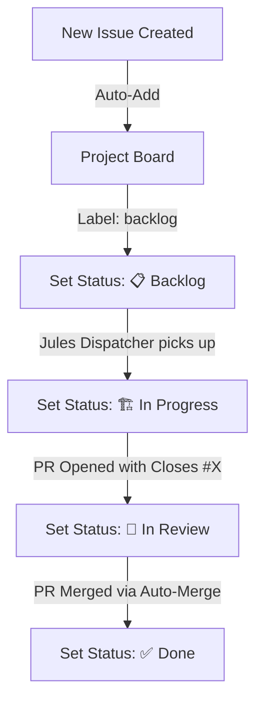

# Yalla GitHub Projects (v2) Architecture & Operating Model

**Project Title**: Yalla Product Engineering & AI-Native SDLC Board
**Target Platform**: GitHub Projects v2
**Owner**: Yalla Engineering Team

---

## 1. Executive Summary

This specification defines the GitHub Projects v2 board architecture for Yalla. It links the product roadmap (Phase 3 Real-Time, Phase 4 Expansion, Phase 5 Mobile, Platform Engineering) with the Anthropic AI-Native SDLC workflow (`intent/` → `specs/` → `plans/` → Jules execution → `evals/check.js`).

---

## 2. Custom Fields Specification

| Field Name | Type | Options / Validation | Description |
|---|---|---|---|
| **Status** | Single Select | `📋 Backlog`<br>`🔍 Intent/Spec (SDLC 1-2)`<br>`🏗️ In Progress (Jules)`<br>`👀 In Review (PR)`<br>`✅ Done` | State machine governing task lifecycle |
| **Phase** | Single Select | `Phase 1-2 (Baseline V2)`<br>`Phase 3 (Real-Time)`<br>`Phase 4 (Expansion)`<br>`Phase 5 (Mobile)`<br>`Platform Engineering` | Product milestone alignment |
| **Priority** | Single Select | `P0 - Critical`<br>`P1 - High`<br>`P2 - Medium`<br>`P3 - Low` | Execution urgency |
| **Module / Pillar** | Single Select | `Realtime & Comms`<br>`Discovery & Booking`<br>`Location & Multi-City`<br>`Host Portal`<br>`Recommendations`<br>`Mobile & Wallet`<br>`Security & Privacy`<br>`Testing & Quality` | Functional architecture domain |
| **SDLC Stage** | Single Select | `Stage 1: Intent`<br>`Stage 2: Spec`<br>`Stage 3: Plan/Build`<br>`Stage 4: Test/Evals`<br>`Stage 5: Deploy`<br>`Stage 6: Maintenance` | AI-Native SDLC lifecycle stage |
| **Estimate** | Number | `1, 2, 3, 5, 8, 13` | Story points effort estimation |

---

## 3. Project Views & Views Configuration

### View 1: 🚀 Product Roadmap Timeline (Roadmap)
- **Layout**: Roadmap / Timeline View
- **Group By**: `Phase`
- **Fields Shown**: `Title`, `Status`, `Priority`, `Module / Pillar`, `Assignees`
- **Purpose**: Strategic view for executive leadership showing quarterly delivery milestones (Q1 2027, Q2 2027, Q3 2027).

### View 2: 🤖 Jules Autonomous Queue (Board)
- **Layout**: Kanban Board
- **Filter**: `is:issue status:"📋 Backlog" label:backlog`
- **Sort**: `Priority` (P0 -> P3), `Created` (Ascending)
- **Purpose**: High-throughput queue consumed by `.github/workflows/jules-dispatch.yml` every 30 minutes.

### View 3: 🔄 AI-Native SDLC Board (Board)
- **Layout**: Kanban Board
- **Group By**: `SDLC Stage`
- **Columns**: `Stage 1: Intent` | `Stage 2: Spec` | `Stage 3: Plan/Build` | `Stage 4: Test/Evals` | `Stage 5: Deploy` | `Stage 6: Maintenance`
- **Purpose**: Real-time visualization of artifacts moving through stage gates (`intent/`, `specs/`, `plans/`, PR, evals).

### View 4: 📊 Architecture & Module Matrix (Table)
- **Layout**: Table View
- **Group By**: `Module / Pillar`
- **Columns**: `Title`, `Status`, `Phase`, `Priority`, `Estimate`, `SDLC Stage`, `Assignees`
- **Purpose**: Full database view for engineering planning and workload balancing.

### View 5: ⚡ Active Sprint Board (Board)
- **Layout**: Kanban Board
- **Group By**: `Status`
- **WIP Limits**: `🏗️ In Progress (Jules)` max 3, `👀 In Review` max 5
- **Purpose**: Daily execution board for active PRs and autonomous agent runs.

---

## 4. Automation Workflows



1. **Auto-Item Ingestion**: Any issue opened in the repository with labels `backlog`, `phase-3`, `phase-4`, `phase-5`, or `platform` is automatically added to the project board.
2. **Field Auto-Populator**: Labels automatically map to Project v2 fields:
   - `phase-3` → `Phase: Phase 3 (Real-Time)`
   - `phase-4` → `Phase: Phase 4 (Expansion)`
   - `phase-5` → `Phase: Phase 5 (Mobile)`
   - `platform` → `Phase: Platform Engineering`
3. **Automated Status Transitions**:
   - Issue assigned to Jules → `Status: 🏗️ In Progress (Jules)`
   - PR opened referencing `Closes #X` → `Status: 👀 In Review (PR)`
   - PR merged to `main` → `Status: ✅ Done`

---

## 5. Synchronizer Integration (`scripts/setup-github-project.js`)

Run the automated setup script to provision fields, configure views, and sync all 16 repository issues:
```bash
node scripts/setup-github-project.js --dry-run
```
