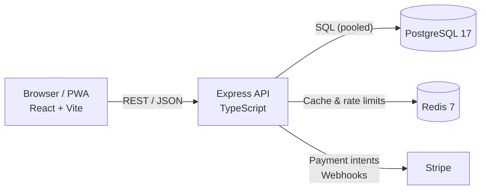

# Yalla

**Managed discovery and booking for small-group local experiences.**

[](https://github.com/xb3sox/yalla/actions/workflows/ci-cd.yml)
[](https://github.com/xb3sox/yalla/actions/workflows/agent-evals.yml)
[](https://nodejs.org)
[](https://www.typescriptlang.org)
[](https://www.w3.org/TR/WCAG22/)
[](./LICENSE)

Yalla is an end-to-end managed platform for curated local activities. Unlike
open marketplaces, every host, venue, schedule, and safety policy is vetted by
Yalla before an experience is listed — so guests can book with confidence and
hosts can focus on running great events.

The product serves Arabic (RTL) and English (LTR), installs as a PWA, and is
built to WCAG 2.2 AA.

## Contents

[Features](#features) · [Tech stack](#tech-stack) ·
[Getting started](#getting-started) · [Configuration](#configuration) ·
[Architecture](#architecture) · [Commands](#commands) ·
[CI](#continuous-integration) · [Docs](#documentation) ·
[Contributing](#contributing) · [Security](#security)

## Features

- **Discovery** — filter curated experiences by category, city, and date.
- **Booking** — seat reservations, waitlists, and Stripe payment intents.
- **Attendance** — 24-hour reconfirmation and an arrival mode with a
  rotating venue check-in PIN.
- **Roles** — scoped access for participants, hosts, operations, support,
  trust & safety, and admin.
- **Feedback** — post-experience ratings that feed host quality control.
- **Localization** — one UI serving Arabic (RTL) and English (LTR).

## Tech stack

| Layer | Stack |
| --- | --- |
| Frontend | React 18, Vite 6, TypeScript 5, Tailwind CSS 4, PWA |
| Backend | Node.js 22, Express 4, TypeScript, Zod, JWT in HttpOnly cookies |
| Data | PostgreSQL 17 (Redis planned for distributed rate limiting — see issue 014; limiter is in-memory today) |
| Payments | Stripe payment intents and webhooks |
| Testing | Vitest, Testing Library, Jest, Supertest, axe |
| Delivery | GitHub Actions, Docker, Nginx |

## Getting started

**Prerequisites:** Node.js 22 (pinned in `.nvmrc`), npm 9+, and PostgreSQL 17.
Docker can supply PostgreSQL and Redis for you.

### 1. Install

```bash
git clone https://github.com/xb3sox/yalla.git
cd yalla
nvm use                       # Node 22
npm ci
npm ci --prefix backend
```

The frontend (repo root) and backend are separate npm projects — install and
run each independently.

### 2. Start dependencies

Skip this if you already have PostgreSQL and Redis running locally.

```bash
docker compose up -d postgres redis
```

### 3. Configure

```bash
cp .env.example .env
cp backend/.env.example backend/.env
```

Set `DATABASE_URL`, `JWT_SECRET`, and `JWT_REFRESH_SECRET` in `backend/.env`.
Everything else has a working local default — see [Configuration](#configuration).

### 4. Create the schema

Required before the API can serve requests.

```bash
npm run migrate --prefix backend
npm run seed --prefix backend     # optional demo data
```

### 5. Run

```bash
npm run dev                    # frontend → http://localhost:5173
npm run dev --prefix backend   # API       → http://localhost:3000
```

Confirm the API is up: `curl http://localhost:3000/health`. Metrics are
exposed at `/metrics` for scraping.

### Docker alternative

Run the full stack, including a database UI, in one command:

```bash
docker compose up --build
```

| Service | URL |
| --- | --- |
| Frontend | <http://localhost:5173> |
| API | <http://localhost:3000> |
| Adminer (database UI) | <http://localhost:8080> |

## Configuration

Frontend settings live in `.env` (only `VITE_`-prefixed values reach the
browser). Backend settings live in `backend/.env`. Full defaults are in
[`.env.example`](./.env.example) and [`backend/.env.example`](./backend/.env.example).

| Variable | File | Purpose |
| --- | --- | --- |
| `VITE_API_URL` | `.env` | API base URL; defaults to `http://localhost:3000/api/v1` |
| `DATABASE_URL` | `backend/.env` | PostgreSQL connection string; required in production |
| `JWT_SECRET`, `JWT_REFRESH_SECRET` | `backend/.env` | Token signing keys — use long random values |
| `STRIPE_SECRET_KEY`, `STRIPE_WEBHOOK_SECRET` | `backend/.env` | Payments and webhook verification |
| `CORS_ORIGIN` | `backend/.env` | Allowed frontend origin |
| `REDIS_URL` | `backend/.env` | Reserved for distributed rate limiting (not yet wired; issue 014) |
| `API_VERSION`, `PORT` | `backend/.env` | Route prefix (default `v1`) and listen port |

> [!NOTE]
> Never commit `.env` files. In production, inject secrets from your platform's
> secret manager rather than bundling them into images.

## Architecture



Both apps follow a layered, dependency-inward design: domain and application
logic stay framework-agnostic, while HTTP, persistence, and third-party
integrations sit at the edges. Reservation state transitions are centralized in
the model layer, and capacity checks run inside atomic, row-locked transactions.
Destructive operations fail closed, and the API shuts down gracefully on
`SIGTERM`/`SIGINT` by draining the connection pool.

## Project structure

```text
.
├── src/            React app — pages, components, domain, application, services
├── backend/        Express API — routes, controllers, models, middleware, migrations
├── docs/           Architecture, API reference, database spec, ADRs
├── intent/         Problem statements (AI-native SDLC stage 1)
├── specs/          Design specifications (stage 2)
├── plans/          Implementation plans (stage 3)
├── evals/          Automated architectural invariant checks
├── scripts/        Automation and drift-monitoring tooling
└── .github/        CI/CD workflows and issue templates
```

## Commands

| Task | Frontend (root) | Backend |
| --- | --- | --- |
| Dev server | `npm run dev` | `npm run dev --prefix backend` |
| Production build | `npm run build` | `npm run build --prefix backend` |
| Type check | `npm run typecheck` | `npm run typecheck --prefix backend` |
| Markdown lint | `npm run lint:md` | — |
| Lint | — | `npm run lint --prefix backend` |
| Unit tests | `npm test` | `npm test --prefix backend -- tests/unit` |
| Coverage | `npm run test:coverage` | `npm run test:coverage --prefix backend` |
| Invariant evals | `node evals/check.js` | — |

> [!IMPORTANT]
> Backend API/model/e2e suites require a live `DATABASE_URL` and an applied
> schema, and must run serially (`-- --runInBand`); `tests/unit` runs without
> a database.

## Continuous integration

| Workflow | Enforces |
| --- | --- |
| [`ci-cd.yml`](./.github/workflows/ci-cd.yml) | Type checks, unit tests, builds, dependency audit |
| [`agent-evals.yml`](./.github/workflows/agent-evals.yml) | Architectural invariants and regression evals |
| [`jules-automerge.yml`](./.github/workflows/jules-automerge.yml) | Blocks auto-merge when sensitive paths change |

Every pull request must pass type checks, tests, and `node evals/check.js`
before review.

## Documentation

| Document | Contents |
| --- | --- |
| [`docs/ARCHITECTURE.md`](./docs/ARCHITECTURE.md) | Layers, domain model, reservation state machine |
| [`docs/API.md`](./docs/API.md) | REST endpoints, payloads, headers, status codes |
| [`docs/DATABASE.md`](./docs/DATABASE.md) | Schema, ER diagram, migrations |
| [`docs/adr/`](./docs/adr/) | Architecture decision records |
| [`AGENTS.md`](./AGENTS.md) | Commands and guardrails for AI coding agents |
| [`CONTRIBUTING.md`](./CONTRIBUTING.md) | Branches, commits, and review standards |
| [`DEPLOYMENT.md`](./DEPLOYMENT.md) | Production deployment guide |
| [`CHANGELOG.md`](./CHANGELOG.md) · [`ROADMAP.md`](./ROADMAP.md) | Release history and planned work |
| [`GLOSSARY.md`](./GLOSSARY.md) | Product domain vocabulary |

## Contributing

Read [CONTRIBUTING.md](./CONTRIBUTING.md) for branch naming, commit
conventions, and review expectations. AI-assisted and autonomous contributions
must also follow [AGENTS.md](./AGENTS.md).

Run the same gates as CI before opening a pull request:

```bash
npm run typecheck
npm run lint:md
npm test
npm run typecheck --prefix backend
npm run lint --prefix backend
npm test --prefix backend -- tests/unit
node evals/check.js
```

## Security

Do not open public issues for vulnerabilities. Report them privately through
[GitHub Security Advisories](https://github.com/xb3sox/yalla/security/advisories/new);
see [SECURITY.md](./SECURITY.md) for scope and response targets.

## License

Proprietary — all rights reserved. Use, copying, modification, and distribution
are prohibited without prior written permission. See [LICENSE](./LICENSE) for
full terms, including contribution and third-party dependency clauses.
