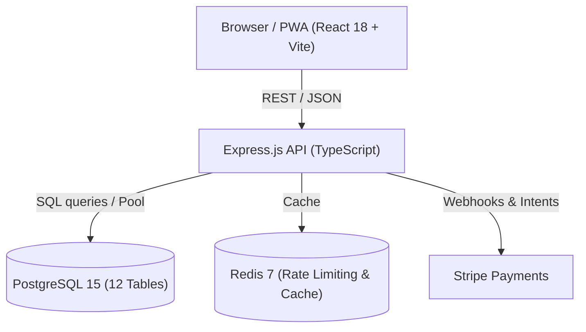

# Yalla - Managed Experience Discovery Platform

**Discover, book, and enjoy local curated experiences with small groups.**

[]()
[]()
[]()
[]()
[]()

---

## Overview

Yalla is an end-to-end managed service platform that allows users to discover, book, attend, and review curated local activities in small groups. Unlike open marketplaces, Yalla exercises end-to-end quality control over experiences, hosts, venues, safety, and schedules.

- **Frontend**: React 18, Vite 6, Tailwind CSS 4, PWA support, bilingual (English & Arabic RTL), WCAG 2.2 AA compliant.
- **Backend**: Express.js, TypeScript, PostgreSQL 15, JWT + HttpOnly cookie authentication, Stripe payments.
- **SDLC**: Anthropic AI-Native SDLC Playbook workflow (`intent/` → `specs/` → `plans/` → evals → guardrails → maintenance monitor).

---

## Architecture & Systems



For complete technical specifications, see:
- 🏛️ **[Architecture Guide](./docs/ARCHITECTURE.md)** — Clean Architecture, Domain-Driven Design, Reservation State Machine.
- 📡 **[API Reference](./docs/API.md)** — 53 REST API endpoints, schemas, headers, status codes.
- 🗄️ **[Database Specification](./docs/DATABASE.md)** — PostgreSQL tables, ER diagram, migrations.
- 📋 **[Product Requirements Document (PRD, archived)](./docs/archive/PRD.md)** — Functional requirements (FR-001 to FR-045) in Arabic.
- 🤖 **[Agent Instructions (AGENTS.md)](./AGENTS.md)** / **[CLAUDE.md](./CLAUDE.md)** — Operational commands and AI agent guardrails.

---

## Quickstart

### Prerequisites
- Node.js 20+ and npm 9+
- PostgreSQL 15 (optional for local mock mode; required for backend integration/E2E tests)

### 1. Installation

```bash
# Install frontend dependencies (repo root)
npm ci

# Install backend dependencies
cd backend && npm ci && cd ..
```

### 2. Environment Setup

```bash
# Copy frontend environment
cp .env.example .env

# Copy backend environment
cp backend/.env.example backend/.env
```

### 3. Running Locally

```bash
# Terminal 1: Run Frontend (http://localhost:5173)
npm run dev

# Terminal 2: Run Backend (http://localhost:3000 or override PORT=3001)
cd backend && npm run dev

> **Note (Production Node.js Preload Requirement)**:
> In production environments, start the compiled backend with the OpenTelemetry preload flag:
> `node --require ./dist/config/tracing.js dist/server.js`
> This ensures Express and PostgreSQL auto-instrumentation intercepts modules before ESM/TS hoisting.
```

### 4. Running with Docker Compose

```bash
docker compose up -d
```
- Frontend: `http://localhost:5173`
- Backend API: `http://localhost:3000`
- Database Adminer: `http://localhost:8080`

---

## Testing & Verification

### Local Verification Commands
```bash
# Frontend type check & unit tests (664 tests)
npm run typecheck
npx vitest run

# Backend type check, lint & unit tests (62 tests)
cd backend
npm run typecheck
npm run lint
npm test -- tests/unit
cd ..

# AI Agent continuous evals
node evals/check.js
```

### CI/CD Pipelines
All commits and pull requests trigger automated GitHub Actions workflows:
- `.github/workflows/ci-cd.yml` — Frontend build, backend build, unit tests, code quality, security scan.
- `.github/workflows/agent-evals.yml` — Architectural invariant regression suite.
- `.github/workflows/jules-automerge.yml` — Automated safe PR merge for Jules coding agent.

---

## AI-Native SDLC Workflow

Yalla implements Anthropic's stage-by-stage AI-Native SDLC:

1. **Stage 1 (Plan)**: Problems captured in `intent/<id>-<slug>.md` using `intent/TEMPLATE.md`.
2. **Stage 2 (Design)**: Specs written to `specs/<id>-<slug>.md` using `specs/TEMPLATE.md`.
3. **Stage 3 (Build)**: Plans committed in `plans/<id>-<slug>.md`; implemented via Jules (`.jules/`).
4. **Stage 4 (Test)**: Test feedback loops and continuous regression evals (`evals/`).
5. **Stage 5 (Deploy)**: Automated PR guardrails preventing unauthorized modifications to sensitive configs.
6. **Stage 6 (Maintain)**: Autonomous drift & breach detection (`scripts/monitor-breach.js`).

---

## Contributing & Development

See [CONTRIBUTING.md](./CONTRIBUTING.md) for branch naming (`jules/<issue-id>-<description>`), commit message conventions, and code review standards.

For production deployment instructions, see [DEPLOYMENT.md](./DEPLOYMENT.md).

---

## License

Proprietary — All rights reserved.
