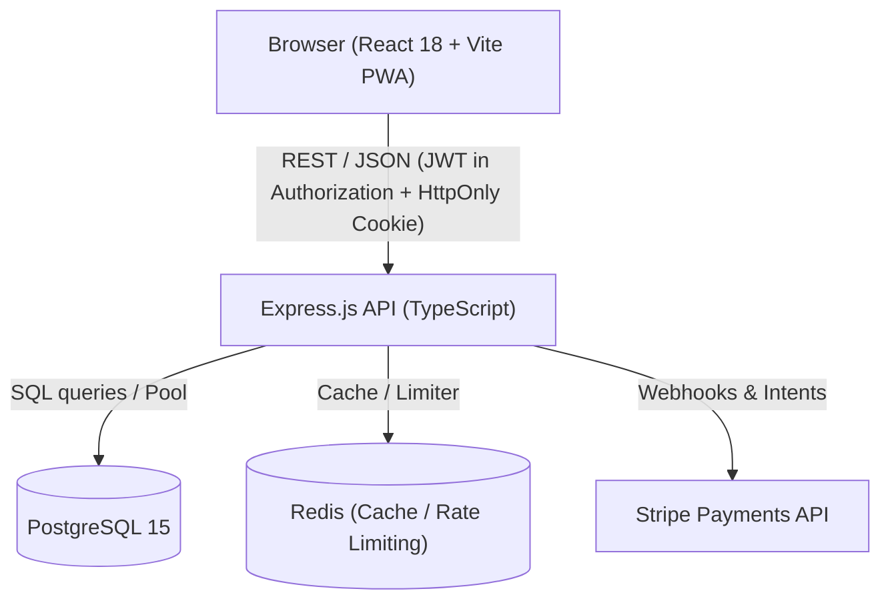
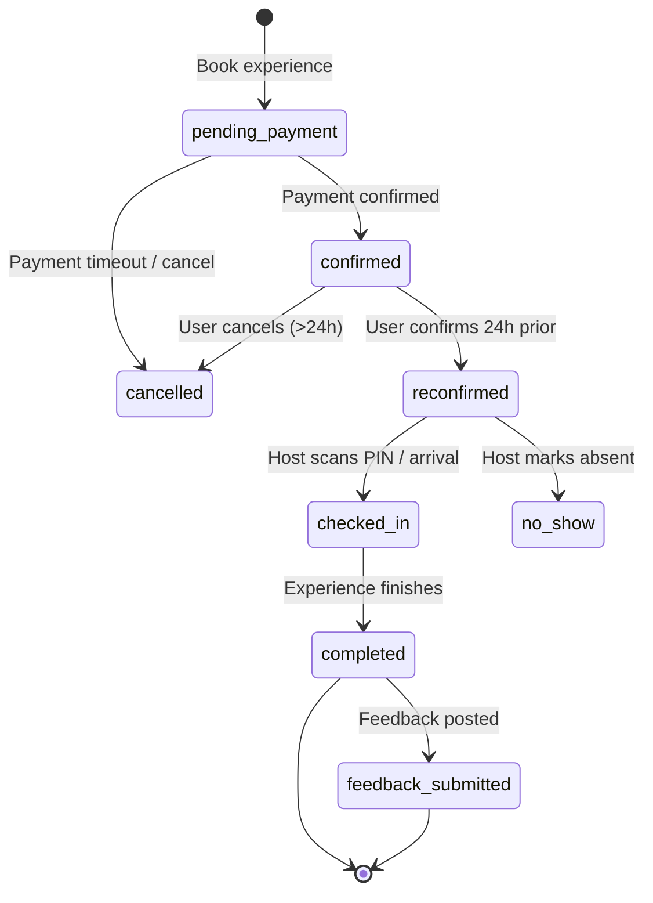

# Yalla Architecture Guide

Clean Architecture and Domain-Driven Design (DDD) specifications for Yalla: Managed Experience Discovery Platform.

---

## 1. Architectural Philosophy

Yalla decouples core business logic from frameworks, UI widgets, and persistence mechanisms.

- **Independent of Frameworks**: Business rules do not depend on React or Express internals.
- **Testable**: Domain entities and use cases execute in isolated test environments without database or DOM mocks.
- **Independent of UI**: The web UI can evolve without impacting reservation state machines or pricing logic.
- **Independent of Database**: PostgreSQL queries and schemas reside in dedicated model/repository layers.

---

## 2. System Topology



---

## 3. Frontend Architecture (`src/`)

Frontend lives at the repository root.

```
src/
├── domain/                  # Enterprise business rules & entities
│   ├── entities/            # Types: Experience, Reservation, User, Payment
│   └── services/            # Pure logic: ReservationStateMachine, Pricing
├── application/             # Application business rules
│   └── useCases/            # Booking, recommendations, reconfirmation, rewards
├── infrastructure/          # Data mappers & mock fallback adapters
│   └── repositories/
├── data/                    # State management (Context + useReducer store)
├── services/                # API client (TTL cache, exponential retry, auth)
├── hooks/                   # Custom hooks (useAuth, useExperience, useToast)
├── components/              # Atomic UI & layout components (40+ reusable)
├── pages/                   # Lazy-loaded route containers
├── i18n/                    # Bilingual translations (Arabic RTL default, English)
└── test/                    # Setup, mocks, accessibility testing suite
```

### Key Frontend Patterns
- **State Store**: Centralized `AppProvider` in `src/data/store.tsx` with immutable action dispatching.
- **API Client**: `src/services/api.ts` provides 5-minute TTL caching with automatic invalidation on mutations (POST/PUT/DELETE) and exponential backoff retry.
- **RTL & Accessibility**: Built-in support for right-to-left layout direction (`dir="rtl"`) with ARIA attributes meeting WCAG 2.2 AA.

---

## 4. Backend Architecture (`backend/src/`)

Backend lives in `backend/` as an independent Express TypeScript application.

```
backend/src/
├── routes/                  # Express route declarations mounted at /api/v1/
├── controllers/             # HTTP transport: request parsing, use-case invocation, status codes
├── models/                  # Database data access layer (parameterized SQL queries)
├── middleware/              # Security headers, auth, rate limiters, validation, sanitization
├── migrations/              # Database schema migrations and seeds
├── config/                  # Environment variable configuration and validation
├── types/                   # TypeScript interfaces and Express typings
└── utils/                   # Structured logger (Winston), token helpers, sanitizers
```

### Security Guardrails
- **Input Sanitization**: Strips HTML tags and recursively removes `__proto__`, `constructor`, and `prototype` keys to prevent prototype pollution.
- **Health Checks**: Public `/health` and `/metrics` return high-level indicators and never leak internal DB error messages.
- **Authentication**: Access tokens (15m JWT) passed in `Authorization` header; refresh tokens (7d) stored in secure, `HttpOnly` cookies.

---

## 5. Reservation State Machine



### Transition Invariants
1. `confirmed` reservations require explicit reconfirmation before arrival mode unlocks venue coordinates.
2. Only `reconfirmed` participants can generate dynamic check-in PINs.
3. Cancellation within 24 hours of event start triggers cancellation penalties based on booking policy.
