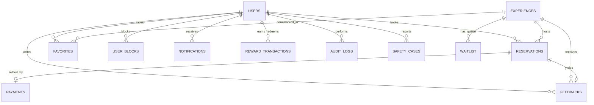

# Yalla Database Schema Specification

PostgreSQL 17 schema specification and migration guide.

---

## 1. Migration Management

Migrations reside in `backend/src/migrations/`:

- `001_initial_schema.ts` — Core tables: users, experiences, reservations, notifications, audit_logs, safety_cases, support_requests, favorites, user_blocks, feedbacks
- `002_add_payments_table.ts` — Stripe payment transaction ledger
- `003_add_receipt_url_to_payments.ts` — Stripe receipt URL storage
- `004_add_rewards_table.ts` — User points balances and transaction history
- `005_add_refunds_table.ts` — Refund ledger tied to reservations and payments
- `006_add_refresh_tokens.ts` — Hashed, revocable refresh tokens (rotation + reuse detection)

### Commands (execute in `backend/`)

```bash
npm run migrate           # Execute all pending migrations
npm run migrate:rollback  # Roll back last migration batch
npm run seed              # Seed database with sample experiences and test accounts
```

---

## 2. Entity Relationship Diagram



---

## 3. Tables & Schema

### `users`

- `id` (UUID, Primary Key)
- `email` (VARCHAR(255), UNIQUE, NOT NULL)
- `password_hash` (VARCHAR(255), NOT NULL)
- `full_name` (VARCHAR(100), NOT NULL)
- `phone` (VARCHAR(20))
- `role` (VARCHAR(20), NOT NULL: `'participant'`, `'host'`, `'staff'`, `'safety_staff'`, `'admin'`)
- `preferences` (JSONB, DEFAULT `'{}'`)
- `status` (VARCHAR(20), DEFAULT `'active'`: `'active'`, `'suspended'`, `'banned'`)
- `created_at` / `updated_at` (TIMESTAMPTZ)

### `experiences`

- `id` (UUID, Primary Key)
- `title_en` / `title_ar` (VARCHAR(255), NOT NULL)
- `description_en` / `description_ar` (TEXT)
- `category` (VARCHAR(50), NOT NULL)
- `city` (VARCHAR(50), NOT NULL)
- `price` (NUMERIC(10, 2), NOT NULL)
- `capacity` (INTEGER, NOT NULL)
- `start_time` / `end_time` (TIMESTAMPTZ, NOT NULL)
- `venue_name` / `venue_address` (TEXT)
- `latitude` / `longitude` (NUMERIC(10, 7) - hidden until arrival mode)
- `host_id` (UUID, FK -> users.id)
- `status` (VARCHAR(20), DEFAULT `'draft'`: `'draft'`, `'published'`, `'completed'`, `'cancelled'`)
- `created_at` / `updated_at` (TIMESTAMPTZ)

### `reservations`

- `id` (UUID, Primary Key)
- `user_id` (UUID, NOT NULL, FK -> users.id)
- `experience_id` (UUID, NOT NULL, FK -> experiences.id)
- `state` (VARCHAR(30), NOT NULL: `'pending_payment'`, `'confirmed'`, `'reconfirmed'`, `'checked_in'`, `'completed'`, `'cancelled'`, `'no_show'`)
- `pin` (VARCHAR(6) - dynamically generated for arrival mode check-in)
- `guest_count` (INTEGER, DEFAULT 1)
- `created_at` / `updated_at` (TIMESTAMPTZ)

### `payments`

- `id` (UUID, Primary Key)
- `reservation_id` (UUID, NOT NULL, UNIQUE, FK -> reservations.id)
- `user_id` (UUID, NOT NULL, FK -> users.id)
- `amount` (NUMERIC(10, 2), NOT NULL)
- `currency` (VARCHAR(3), DEFAULT `'SAR'`)
- `status` (VARCHAR(20), NOT NULL: `'pending'`, `'succeeded'`, `'failed'`, `'refunded'`)
- `stripe_payment_intent_id` (VARCHAR(255), UNIQUE)
- `receipt_url` (TEXT)
- `created_at` / `updated_at` (TIMESTAMPTZ)

### `rewards` & `reward_transactions`

- `rewards`: `user_id` (UUID, PK), `points_balance` (INTEGER), `tier` (VARCHAR)
- `reward_transactions`: `id` (UUID, PK), `user_id` (UUID, FK), `points` (INTEGER), `type` (`'earned'`, `'redeemed'`, `'adjusted'`), `description` (TEXT), `created_at` (TIMESTAMPTZ)

### `feedbacks`

- `id` (UUID, Primary Key)
- `reservation_id` (UUID, NOT NULL, UNIQUE, FK -> reservations.id)
- `experience_id` (UUID, NOT NULL, FK -> experiences.id)
- `user_id` (UUID, NOT NULL, FK -> users.id)
- `rating` (INTEGER, CHECK 1-5)
- `worth_time` (BOOLEAN, NOT NULL)
- `comments` (TEXT)
- `created_at` (TIMESTAMPTZ)

### `safety_cases`

- `id` (UUID, Primary Key)
- `reporter_id` (UUID, NOT NULL, FK -> users.id)
- `reported_id` (UUID, FK -> users.id)
- `experience_id` (UUID, FK -> experiences.id)
- `severity` (VARCHAR(20): `'low'`, `'medium'`, `'high'`, `'critical'`)
- `status` (VARCHAR(20): `'reported'`, `'under_review'`, `'action_taken'`, `'dismissed'`)
- `description` (TEXT, NOT NULL)
- `internal_notes` (JSONB, DEFAULT `'[]'`)
- `created_at` / `updated_at` (TIMESTAMPTZ)

### `audit_logs`

- `id` (UUID, Primary Key)
- `actor_id` (UUID, FK -> users.id)
- `action` (VARCHAR(100), NOT NULL)
- `resource_type` (VARCHAR(50), NOT NULL)
- `resource_id` (VARCHAR(100))
- `payload` (JSONB)
- `ip_address` (VARCHAR(45))
- `created_at` (TIMESTAMPTZ, NOT NULL)
