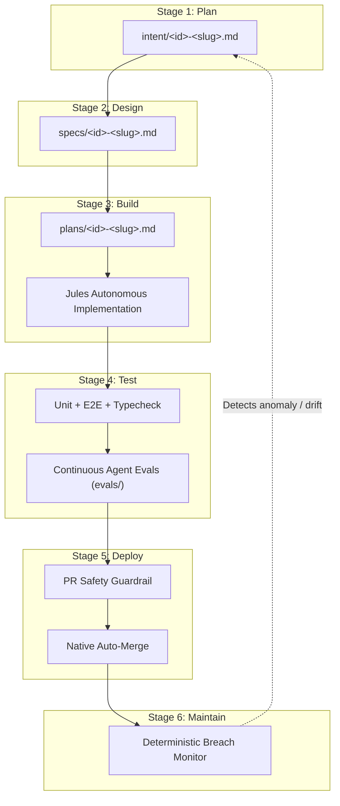

# Spec: AI-Native SDLC Architecture & Repo Standardization

**Intent Reference**: `intent/001-repo-organization-sdlc.md`  
**Author**: Antigravity / Jules Architecture  
**Date**: 2026-10-19  
**Status**: approved  

---

## 1. Executive Summary
Transform Yalla into an AI-native product repository governed by committed markdown artifact chains, automated test feedback loops, continuous agent evaluations, and closed-loop maintenance monitoring, as defined by Anthropic's AI-Native SDLC Playbook.

---

## 2. Six-Stage SDLC Pipeline Architecture

### Stage 1: Plan (`intent/`)
- Human or automated monitor writes `intent/*.md`.
- Acts as proto-spec defining problem, desired outcome, constraints.
- Product owner accepts artifact into version control.

### Stage 2: Design (`specs/`)
- Agent generates `specs/*.md` referencing accepted intent.
- Applies enterprise policy standards (WCAG 2.2 AA accessibility, security sanitization, RTL).
- Flags critical escalation areas for human sign-off.

### Stage 3: Build (`plans/` & Jules)
- Plan mode produces `plans/*.md` listing exact files changing, order of work, and verification tests.
- Jules implements autonomously following pre-PR checklist and branch naming `jules/<issue-id>-<description>`.
- Knowledge codified in concise `AGENTS.md` and `CLAUDE.md`.

### Stage 4: Test (Feedback Loop & Continuous Evals)
- Local feedback loops: `npm run typecheck`, `npx vitest run`, `cd backend && npm test -- tests/unit`.
- Evaluation suite in `evals/` ensures agent prompts and repository rules do not regress over time.

### Stage 5: Deploy (Guardrails & Auto-Merge)
- `.github/workflows/jules-automerge.yml` validates PR safety, blocking any modifications to sensitive config files.
- Automated squash merge on green CI.

### Stage 6: Maintain (Closing the Loop)
- `scripts/monitor-breach.js` runs deterministically (cron or post-deploy check).
- Evaluates endpoint health and test suite stability.
- If health or metrics fail, creates `intent/<timestamp>-breach-diagnosis.md` to feed directly back into Stage 1.

---

## 3. Areas of Concern & Governance
> [!NOTE]
> Autonomous PR auto-merge must never permit unreviewed modifications to `.github/workflows/`, `AGENTS.md`, `CLAUDE.md`, `.env`, or build configs. This hard boundary is enforced in GitHub Actions.
