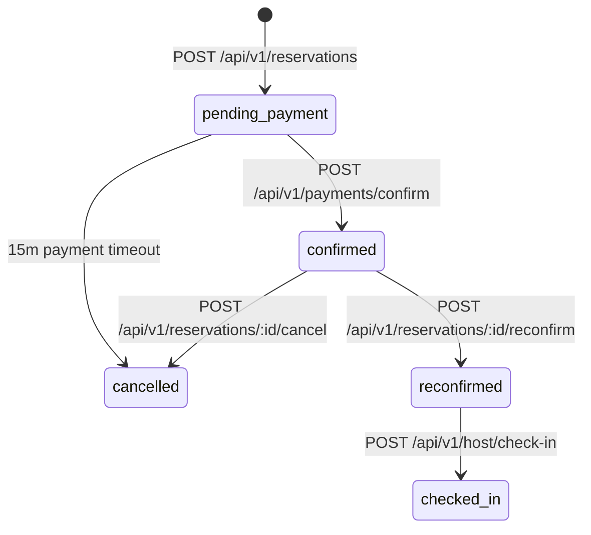

# Spec: Experience Discovery, Booking & Payment Lifecycle

**Intent Reference**: `intent/002-discovery-booking-payments.md`  
**PRD Alignment**: FR-001 through FR-008, Business Rules BR-01 to BR-08  
**Author**: Systems Architect  
**Date**: 2026-10-19  
**Status**: approved  

---

## 1. Executive Summary

Specification for Yalla's core commerce pipeline. Covers catalog browsing, detail view with live capacity, waitlist entry, pending reservation reservation creation, Stripe Payment Intent generation, and state transition to `confirmed`.

---

## 2. Requirements & State Lifecycle

### Functional Requirements

- **FR-001**: List experiences with category, area, city, and date filtering.
- **FR-002**: View experience details (title, description, host, schedule, base price).
- **FR-003**: Reserve seat creating `pending_payment` reservation.
- **FR-004**: Join waitlist if `capacity - confirmed_count <= 0`.
- **FR-005**: Confirm payment through Stripe webhook or client confirmation endpoint.
- **FR-006**: 24-hour attendance reconfirmation gateway.
- **FR-007**: Cancellation prior to 24h cutoff with automated refund trigger.
- **FR-008**: Material change review and acceptance.

### State Transition Diagram

---

## 3. Technical Architecture & Endpoints

### Backend Routes (`backend/src/routes/`)

- `GET /api/v1/experiences` -> `experience.controller.ts:getExperiences`
- `GET /api/v1/experiences/:id` -> `experience.controller.ts:getExperienceById`
- `POST /api/v1/reservations` -> `reservation.controller.ts:createReservation`
- `POST /api/v1/reservations/waitlist` -> `reservation.controller.ts:joinWaitlist`
- `POST /api/v1/payments/intent` -> `payment.controller.ts:createPaymentIntent`
- `POST /api/v1/payments/confirm` -> `payment.controller.ts:confirmPayment`

### Frontend Application Layer

- `src/application/useCases/bookingUseCase.ts` (`createBooking`, `cancelBooking`)
- `src/domain/services/ReservationStateMachine.ts` (Validates allowable transitions)
- `src/services/api.ts` (`api.experiences`, `api.reservations`, `api.payments`)

---

## 4. Policy Constraints & Security

- **Idempotency**: All payment intent creations use `reservation_id` as the Stripe idempotency key.
- **Capacity Safety**: Overbooking prevented via database row locking (`SELECT FOR UPDATE` on experiences).
- **PII Scrubbing**: Stripe payment methods stored as tokens only; no raw cardholder details persist.
