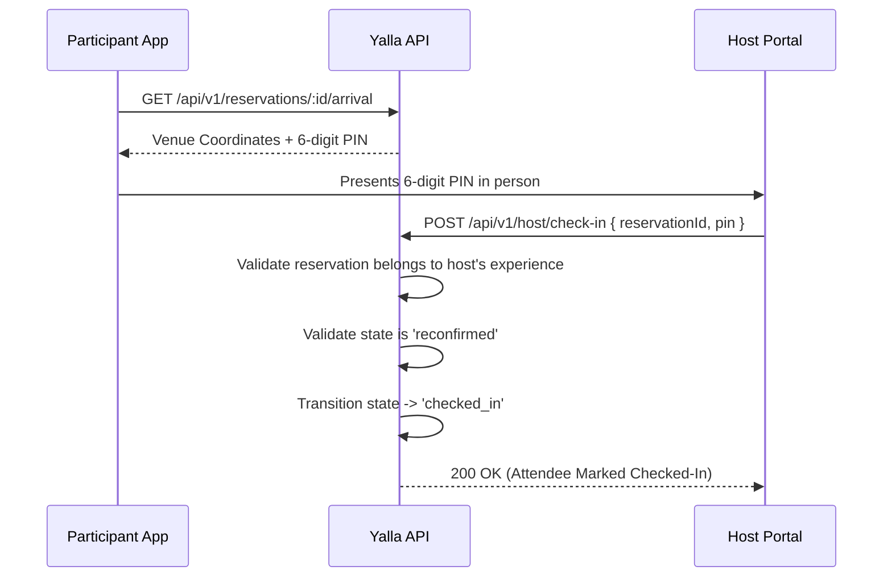

# Spec: Arrival Mode, Protected Venue & Host Verification

**Intent Reference**: `intent/003-arrival-mode-protected-venue.md`  
**PRD Alignment**: FR-009 to FR-012, Business Rules BR-09 to BR-12  
**Author**: Security & Experience Lead  
**Date**: 2026-10-19  
**Status**: approved  

---

## 1. Executive Summary

Architecture for arrival protection: venue obfuscation until 24-hour attendance reconfirmation, dynamic time-limited PIN check-in, and real-time host roster verification.

---

## 2. Requirements & Security Invariants

### Functional Requirements

- **FR-009**: Exact venue details (name, street, lat/lng, parking instructions) visible only to confirmed and reconfirmed participants.
- **FR-010**: Display host bio, verified badge, and operational contact channels during arrival window.
- **FR-011**: Dynamic 6-digit PIN displayed on participant device for check-in.
- **FR-012**: In-app emergency assistance and operational support request button.

### Data Protection Invariant

```text
Public Experience DTO: { id, title, description, city, neighborhood, price } -> Lat/Lng STRIPPED
Arrival Mode DTO:       { id, venue_name, venue_address, latitude, longitude, pin } -> UNLOCKED IF state in ['reconfirmed', 'checked_in']
```

---

## 3. Host Verification Workflow



---

## 4. Endpoints & Enforcement

- `GET /api/v1/reservations/:id/arrival` -> Checks user authentication & `reconfirmed` state.
- `GET /api/v1/host/experiences/:id/roster` -> Host-only access; displays attendee names, dietary notes, and check-in status.
- `POST /api/v1/host/check-in` -> Validates host authorization and checks PIN against database record.
