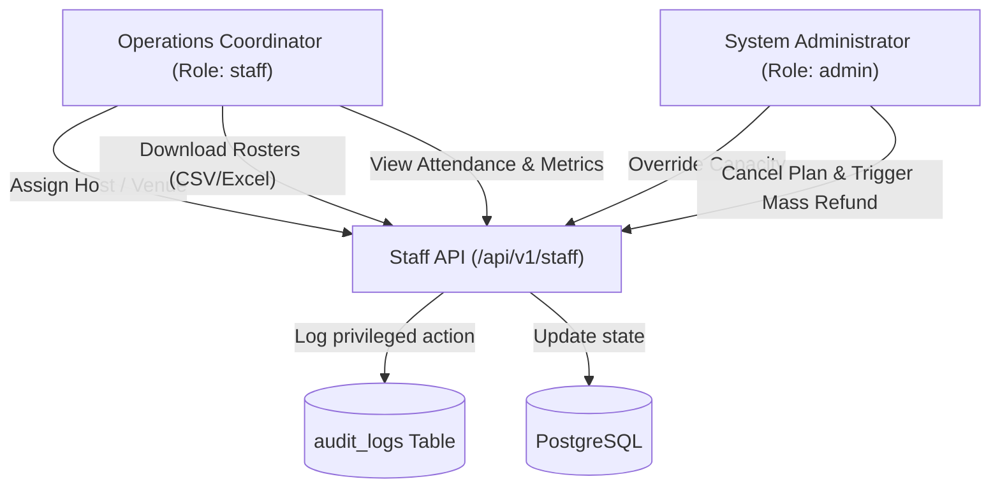

# Spec: Staff Operations, Capacity Overrides & Attendance Auditing

**Intent Reference**: `intent/004-staff-operations-capacity.md`  
**PRD Alignment**: FR-027 to FR-036, Business Rules BR-13 to BR-18  
**Author**: Operations Architecture  
**Date**: 2026-10-19  
**Status**: approved  

---

## 1. Executive Summary
Architecture for the operations management tier. Enforces role-based permissions (`staff`, `admin`), host and venue assignment workflows, auditable capacity adjustments, and data export endpoints.

---

## 2. Operations Workflows & Permissions

---

## 3. Endpoints & Data Model

### Routes (`backend/src/routes/staff.routes.ts`)
- `GET /api/v1/staff/dashboard` — Live operations dashboard KPIs (occupancy, active hosts, pending requests).
- `GET /api/v1/staff/experiences` — Operational experience schedule list.
- `POST /api/v1/staff/assign-host` — Link `host_id` to experience record.
- `POST /api/v1/staff/assign-venue` — Update venue address and secret coordinates.
- `GET /api/v1/staff/attendance/:experienceId` — Attendee roster with check-in timestamps.
- `POST /api/v1/staff/export/reservations` — Generate CSV / Excel spreadsheet via `json2csv` and `exceljs`.
- `POST /api/v1/staff/override-capacity` — Admin-only capacity expansion with mandatory reason string.

---

## 4. Policy Constraints & Compliance
- **Audit Logging**: Any capacity modification or manual check-in writes an immutable record to `audit_logs` within the same database transaction.
- **Role Enforcement**: `requireRole(['staff', 'admin'])` middleware verifies JWT claims before invoking controllers.
