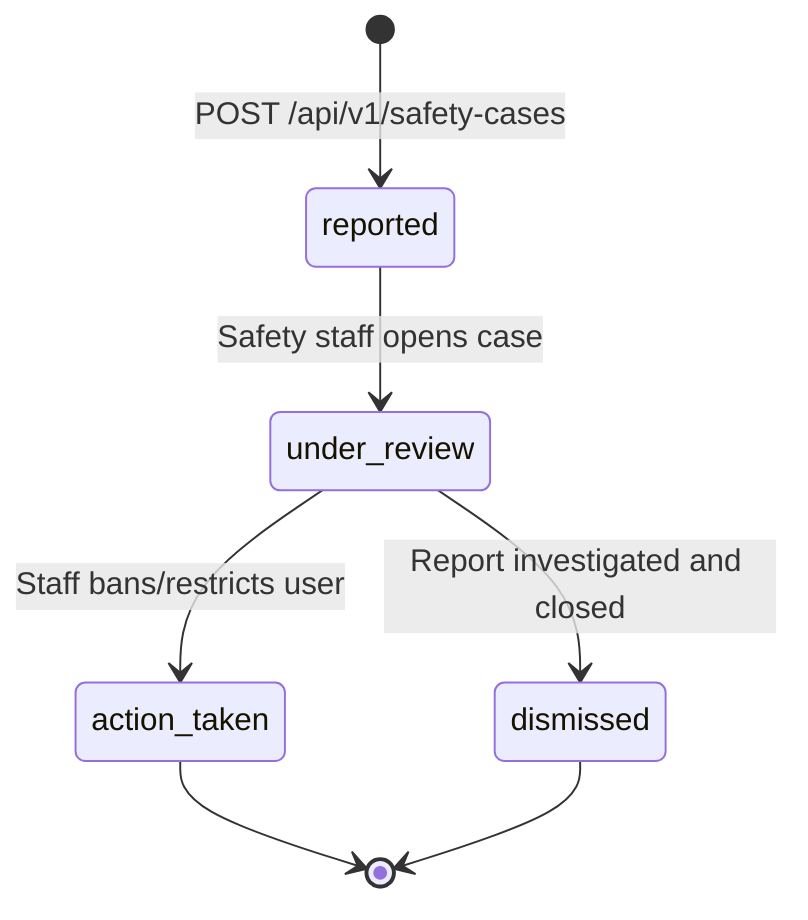

# Spec: Trust, Safety Cases & Audit Logging

**Intent Reference**: `intent/005-trust-safety-audit.md`  
**PRD Alignment**: FR-022 to FR-026, FR-037 to FR-039  
**Author**: Trust & Safety Systems Architecture  
**Date**: 2026-10-19  
**Status**: approved  

---

## 1. Executive Summary
Specification for Yalla's Trust & Safety architecture: restricted incident handling, bilateral user blocking, and an immutable audit log.

---

## 2. Requirements & State Machine

### Safety Case Lifecycle

### Access Control Invariant
- `safety_cases` table readable only by users with role `safety_staff` or `admin`.
- `user_blocks` table queried automatically during experience group assignment to ensure blocked users never share a group reservation.

---

## 3. Endpoints & Schemas

### Safety Cases (`/api/v1/safety-cases`)
- `POST /` — Participant submits confidential safety report.
- `GET /` — List open cases (restricted to `safety_staff`, `admin`).
- `GET /:id` — Detailed incident view with timeline.
- `PUT /:id/status` — Advance state (`under_review`, `action_taken`, `dismissed`).
- `POST /:id/notes` — Append internal investigation notes (JSONB array).
- `POST /:id/restrict-user` — Admin endpoint to ban or suspend reported user.

### User Blocks (`/api/v1/blocks`)
- `GET /` — List IDs of blocked users.
- `POST /:userId` — Block user.
- `DELETE /:userId` — Remove block.

### Audit Logging (`/api/v1/audit`)
- `GET /` — Filterable audit trail (`actor_id`, `action`, `resource_type`, `date_range`).
- `GET /export` — Compliance audit CSV export.

---

## 4. Policy Constraints & Compliance
- **Data Protection**: Safety reports are classified as **Restricted**. They are excluded from general user data export packages to protect third-party identities.
- **Append-Only Immutability**: The `audit_logs` model only exposes `create()` and `find()` methods; no `update` or `delete` queries exist.
