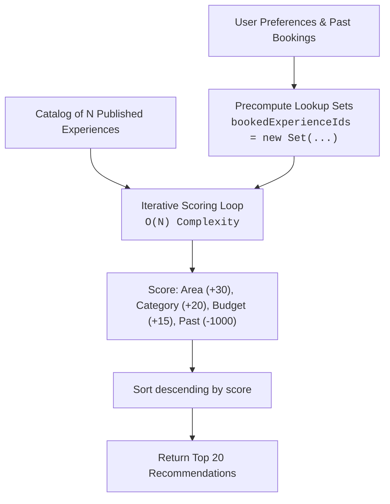

# Spec: Feedback, Loyalty Rewards & Recommendation Engine

**Intent Reference**: `intent/006-feedback-rewards-recommendations.md`  
**PRD Alignment**: FR-013 to FR-015, FR-041 to FR-043  
**Author**: Growth & Machine Intelligence Lead  
**Date**: 2026-10-19  
**Status**: approved  

---

## 1. Executive Summary
Technical architecture for post-event retention: verified feedback capture, points transaction ledger with balance redemption, and a linear-time $O(N)$ recommendation scoring engine.

---

## 2. Recommendation Algorithm Architecture

### Complexity Invariant (Bolt Rule)
- Quadratic/Cubic iteration ($O(N \cdot R \cdot F)$) is strictly prohibited.
- User past booking IDs and feedback sets are precomputed once outside the loop into `Set<string>`.
- Inner loop queries `Set.has()` in $O(1)$ constant time, keeping total complexity strictly $O(N + R + F)$.

---

## 3. Endpoints & Data Models

### Feedback (`/api/v1/feedbacks`)
- `POST /` — Submit review (`reservation_id`, `rating` 1-5, `worth_time` boolean, `comments`).
  - Requires reservation ownership and state `completed`.
- `GET /experience/:experienceId` — Public aggregated review scores.

### Rewards (`/api/v1/rewards`)
- `GET /balance` — Current points balance and tier (`Bronze`, `Silver`, `Gold`).
- `GET /history` — Points ledger with earned and redeemed transactions.
- `POST /redeem` — Deduct points and return discount promo code.

### Recommendations (`/api/v1/experiences/recommendations`)
- `GET /` — Returns personalized experience list scored by user interest and budget.

---

## 4. Policy Constraints & Compliance
- **Duplicate Prevention**: `feedbacks.reservation_id` has a `UNIQUE` constraint, returning HTTP 409 Conflict on repeated attempts.
- **Points Balance Integrity**: Redemption uses a transactional check: `UPDATE rewards SET points_balance = points_balance - $1 WHERE points_balance >= $1`.
