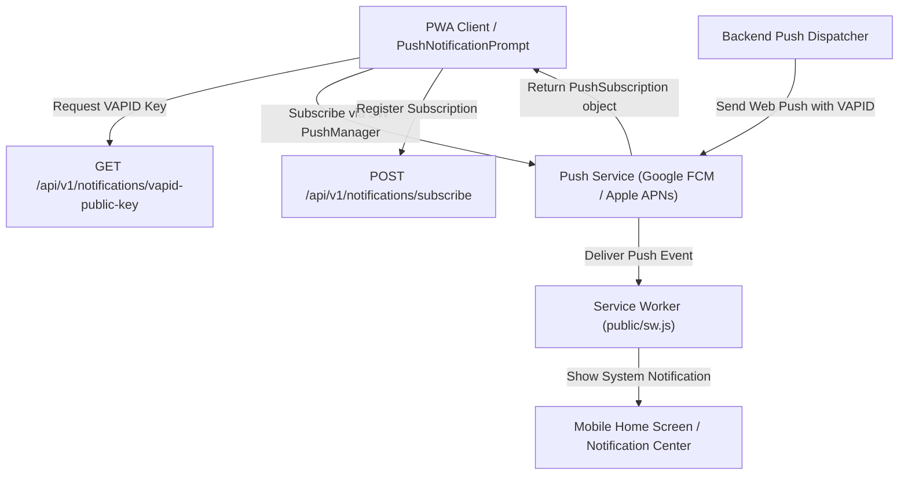

# Spec: Web Push Notification Service Workers & VAPID Keys for Mobile PWA

**Intent Reference**: `intent/007-web-push-notifications.md`
**PRD Alignment**: FR-050 to FR-053
**Author**: Mobile Experience Lead
**Date**: 2027-01-15
**Status**: approved

---

## 1. Executive Summary
Technical specification for Mobile PWA Web Push notification delivery using Web Push protocol, Service Worker push event processing, VAPID key pair authentication, and PostgreSQL push subscription persistence.

---

## 2. System Architecture



---

## 3. Endpoints & Data Models

### Database Schema (`push_subscriptions`)
```sql
CREATE TABLE IF NOT EXISTS push_subscriptions (
  id UUID PRIMARY KEY DEFAULT gen_random_uuid(),
  user_id UUID NOT NULL REFERENCES users(id) ON DELETE CASCADE,
  endpoint TEXT NOT NULL UNIQUE,
  keys JSONB NOT NULL,
  user_agent TEXT,
  created_at TIMESTAMP WITH TIME ZONE DEFAULT CURRENT_TIMESTAMP,
  updated_at TIMESTAMP WITH TIME ZONE DEFAULT CURRENT_TIMESTAMP
);
CREATE INDEX IF NOT EXISTS idx_push_subscriptions_user_id ON push_subscriptions(user_id);
```

### API Contracts (`/api/v1/notifications`)
- `GET /vapid-public-key`: Returns `{ success: true, data: { publicKey: string } }`.
- `POST /subscribe`: Authenticated. Request body: `{ subscription: { endpoint: string, keys: { p256dh: string, auth: string } } }`. Stores or updates subscription record.
- `DELETE /unsubscribe`: Authenticated. Request body: `{ endpoint: string }`. Removes push subscription endpoint.

---

## 4. Service Worker Specification
- `push` handler parses payload JSON and passes options:
  - `title`, `body`, `icon` (`/pwa-192x192.png`), `badge` (`/pwa-96x96.png`).
  - RTL Support: `dir: 'rtl'`, `lang: 'ar'`.
- `notificationclick` handler closes notification and navigates/focuses target route URL (`data.url`).

---

## 5. Pruning & Security Policy
- HTTP 404 (Not Found) or HTTP 410 (Gone) from push service endpoint triggers automatic deletion of subscription record.
- VAPID private key is accessed strictly via backend configuration and environment variables.
